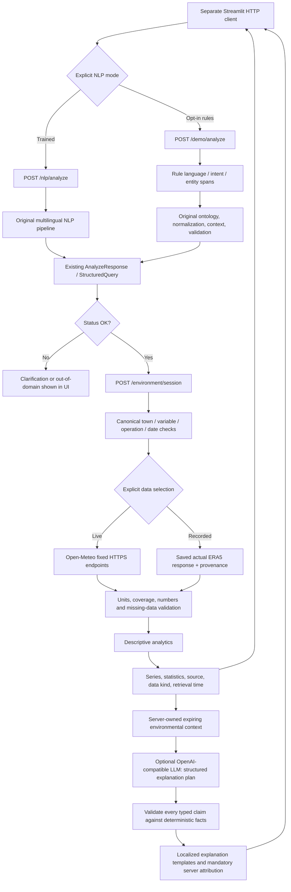

# TerraMind academic prototype architecture

This document describes the additive evaluation prototype. Original design and
model evaluation documents are preserved as records of the earlier NLP-only
implementation. The system is not a completed Earth System Digital Twin.

## Data flow



## Original NLP subsystem: preserved

`backend/nlp/` and `backend/api/app.py` are unchanged. The original
`NlpPipeline.from_settings()` still loads:

- Character n-gram Hindi/Nepali detector at
  `models/language_detection/hi_ne.joblib`; script rules separate English.
- Intent XLM-R checkpoint selected by
  `models/intent/full/summary.json` → `seed_<best_seed>/`.
- NER XLM-R checkpoint selected independently from `models/ner/full/`.
- Calibration/decision thresholds at `models/decision/thresholds.json`.
- E5 domain neighbour index at `models/decision/domain_index.npz` and the
  `intfloat/multilingual-e5-small` encoder from the Transformers/Hugging Face
  cache. E5 uses `query: ` prefix, max length 64 and unit-normalized mean pooling.
- Original entity normalization, ontology, context resolver, operation cues,
  query structuring and validation.

The query schema, enums and canonical IDs remain the downstream contract.
Existing calibrated confidence and out-of-domain behavior are unchanged.
The public clone has none of the trained artifacts. A missing artifact yields
`models_loaded=false` and HTTP 503 from `/nlp/analyze`; no rules are substituted.
Checkpoint quality and restored trained inference have not been verified here.

## Explicit demonstration path

`backend/presentation/demo.py` is a separate class, not a replacement classifier
or monkey-patch of the original pipeline. It uses native-script cues for
language, a small intent cue list, and longest-match ontology aliases for spans.
Those steps are deterministic and have no calibrated confidence. Existing
normalization, context, structuring and validation are reused. Only this
separate demo adds a small ISO date-range recognizer. Missing periods request
clarification rather than applying a presentation default.

The API returns the same `AnalyzeResponse` shape, with demo warnings and zero
confidence placeholders documented as unmeasured. The UI prominently labels the
mode. These rules are for documented questions, not unrestricted natural
language; complex wording, unknown locations and language ambiguity remain
limits. Original model quality metrics do not apply to these rules.

## Central FastAPI backend

`backend/presentation/app.py` builds on the original `create_app()` factory and
adds routes. Original source files and response contracts are not edited.

| Route | Behavior |
| --- | --- |
| `GET /health` | Original trained-pipeline health, unchanged |
| `POST /nlp/analyze` | Original trained pipeline, unchanged; 503 if unavailable |
| `GET /system` | Presentation capabilities, demo enabled flag, limitations |
| `POST /demo/analyze` | Explicit rule path, enabled only with `TERRAMIND_DEMO=1` |
| `POST /environment/query` | Existing StructuredQuery plus explicit `source_mode`; retrieval and statistics, unchanged |
| `POST /environment/session` | Retrieval, context token and optional validated explanation; new envelope |
| `POST /genai/explain` | Explain/follow up using the server-held environmental context |

The environment body is `{"query": <StructuredQuery>, "source_mode": "live"}`
or `"snapshot"`. It is an additional envelope, not a replacement NLP schema.
The response status is `ok`, `needs_clarification` or `unavailable`. Unsupported
semantics are clarifications; external failures are unavailable. Invalid request
shape is HTTP 422. Partial successful town responses remain inspectable when
another town fails, but the UI suppresses a complete comparison in that case.

NLP context is guarded by the original lock; demo context has a separate lock
and session store. Streamlit gives each browser session an opaque UUID and a
new-conversation control. State is in-memory and requires a single backend
worker. This is a local academic service without production authentication.

## Environmental data layer

`backend/environment/provider.py` owns all provider HTTP calls. Fixed endpoint
URLs and vetted coordinates avoid passing raw question text to external tools.
The original NLP modules perform no weather retrieval.

| Feature | Implementation |
| --- | --- |
| Town mapping | `loc:gangtok`, `loc:namchi`, `loc:mangan` from original ontology |
| Coordinates | GeoNames via Open-Meteo geocoding; selected India/Sikkim town results |
| Older ranges | `https://archive-api.open-meteo.com/v1/archive`, explicit `models=era5` |
| Recent/current | `https://api.open-meteo.com/v1/forecast`, model past data/current output |
| Time | ISO dates, timezone `Asia/Kolkata`; retrieval timestamps are timezone-aware UTC |
| Temperature | Daily mean/min/max at 2 m, °C |
| Precipitation | Canonical `PRECIPITATION` → precipitation_sum, mm, includes snow water equivalent |
| Rainfall | Archive rain_sum; forecast rain_sum + showers_sum, mm |
| Current | Timestamp and interval; temperature and precipitation/rainfall kept separate from daily aggregates |
| Attribution | Provider name, exact request URL, CC BY 4.0 link, ECMWF/Copernicus historical credit |

`backend/environment/service.py` validates completeness and routes supported
operations. No free-text location geocoding happens on each request. A district
is never silently mapped to its administrative town. At most three distinct
towns and 366 days are allowed. Relative past periods end yesterday in local
time; month/year amounts use calendar arithmetic. Future periods, unsupported
variables, disaster/scenario/causal operations and missing periods request
clarification. The original NLP trend default is not silently accepted by the
data service when the request omitted its period.

ERA5 has about five days of publication delay; this adapter uses an additional
day's margin and sends ranges ending at least six days ago to ERA5. More recent
ranges use forecast-model past data, restricted to its 92-day window. Long
ranges crossing that window boundary ask for a revised range instead of
silently stitching scientifically different products.

Provider responses are checked for matching units/timezone, exact requested
date coverage, aligned arrays, finite numeric values and nonnegative rainfall.
Nulls remain null. Transport errors, HTTP errors and malformed data become
visible unavailable results with no automatic fallback. Provider bodies are
not echoed into user errors.

`backend/environment/snapshots/` contains three real, small ERA5 responses for
1–7 January 2025, with source URLs and original retrieval timestamps. Explicit
snapshot selection does not make an HTTP request and only serves the recorded
period. The UI and warnings state that the data were previously retrieved.

## Analytics layer

`backend/environment/analytics.py` computes arithmetic mean of available daily
mean temperatures, minimum of available daily minima, maximum of daily maxima,
and sums of available rainfall/precipitation. It reports valid-day counts for
each field. All-missing fields return null, never zero; incomplete totals are
labelled partial. All-missing provider data make the service unavailable.

The time-series charts display provider daily values; comparisons use the same
period for all requested towns. No statistical climate-trend test, causal
analysis, disaster model or future prediction is implemented. Data kind is
reported independently of the original intent's `answer_kind`: a request for
an observation can be answered with explicitly labelled reanalysis/model data,
without claiming those estimates are station observations.

## Independent Streamlit client

`streamlit_app/app.py` renders project scope, input, NLP status/entities/JSON,
weather series, statistics, comparison and provenance. It calls only the HTTP
client in `api_client.py`; it imports no backend logic. `config.py` holds the
backend URL and examples. API/mode selection is explicit, and stale results
are cleared before a new submission so a failed request cannot leave old data
presented as the new answer. Result captions retain the actual modes used even
if the sidebar selection later changes.

No original frontend is in the public branch. No frontend files were deleted,
renamed or overwritten. Any laptop-only frontend can keep using the original
NLP routes independently; its startup cannot be verified without its files.

## Scientific and operational limits

Open-Meteo results are gridded model/reanalysis estimates, not local station
measurements. ERA5's resolution and grid elevation are substantial limitations
in mountainous Sikkim. Town coordinates are points, not boundaries or spatial
averages. Today's daily statistics contain forecast hours. No data are
fabricated, and no rule-based demo confidence is sold as model probability.

No database, background ingestion, cache refresh scheduler, RAG, hazard
prediction or scenario engine was added. An optional constrained LLM explanation
layer is now implemented as described below. No pretrained models were downloaded
or trained. The next meaningful steps are restoring original checkpoints,
verifying trained inference on actual multilingual questions, fluent-speaker
review and validated observations/geographic coverage.

## Provider references and licensing

Reviewed 15 November 2026:

- https://open-meteo.com/en/docs/historical-weather-api — historical coverage
  from 1940, ERA5 delay, variables, units and reanalysis semantics.
- https://open-meteo.com/en/docs — current/recent model output, rain/showers,
  timestamps, daily statistics and past-data window.
- https://open-meteo.com/en/docs/geocoding-api — GeoNames coordinate source.
- https://open-meteo.com/en/terms — free API is for noncommercial use, CC BY 4.0;
  fewer than 10,000 calls/day, 5,000/hour and 600/minute. This academic local
  demonstration makes up to three requests per submitted question. Commercial
  deployment needs a separate terms/license review.
- https://creativecommons.org/licenses/by/4.0/ — attribution license.

Live availability was verified, including a real historical Gangtok response,
not inferred only from documentation. Verification evidence and known gaps are
recorded in `FINAL_VERIFICATION.md` and the demo guide.


## Grounded GenAI layer

`backend/genai/` is independent of NLP and runs only **after** weather retrieval
and deterministic analytics. This is a genuine OpenAI-compatible Chat Completions
integration, not a canned provider simulator. Live provider verification still
requires explicit configuration and credentials. Its scope is constrained
explanation generation: an LLM selects and orders relevant typed claims; the
server validates those claims and renders them through fixed English/Hindi/Nepali
templates. It does not accept unrestricted model prose. This restriction is a
deliberate way to make numerical and source validation enforceable; matching
numbers with a regex in arbitrary prose would not prove factual correctness.

Modules:

- `client.py`: provider selection/configuration and bounded JSON-over-HTTPS
  `/chat/completions` requests using existing httpx; no SDK/dependency additions.
- `context.py`: server-owned successful `EnvironmentResponse` copies, keyed by
  random bearer context tokens bound to browser session IDs; latest successful
  result per session, maximum 128 entries and hard 900-second TTL.
- `facts.py`: recomputes summaries from server-retrieved daily rows; compiles
  finite, rounded-to-two-decimal claims and source metadata. Same-period,
  same-data-kind comparisons are calculated here only with complete coverage.
- `schema.py`: strict plan/claim and public explanation schemas.
- `service.py`: prompts the provider, rejects ungrounded or malformed plans,
  renders accepted facts, and returns safe disabled/unavailable/rejected states.

### API and lifecycle

`POST /environment/session` accepts the existing environmental request fields
plus a required `session_id` and `language` (`en`, `hi`, `ne`). It returns:

```json
{
  "environment": {"status": "ok", "query": {}, "results": [], "errors": []},
  "context_id": "opaque-token-from-server",
  "explanation": {"status": "disabled", "language": "en", "text": null}
}
```

The JSON above illustrates envelope shape, not a valid complete weather result.
The existing `/environment/query` contract is unchanged. The dashboard uses the
new envelope so a failure in optional generation cannot discard data retrieval.
Successful environmental results are stored whether or not an LLM is configured.
Unavailable/clarification results do not get a context token.

`POST /genai/explain` accepts `session_id`, `context_id`, `language`, and a
`question` of at most 500 characters. It does **not** accept client-provided
weather results, summaries, claims or source URLs. Context is not built from
previous model answers, and follow-ups do not extend its TTL. New successful
retrieval replaces the previous context for that session. Missing, expired or
wrong-session tokens return `no_context` without contacting a provider. Context
is in-memory, per-process and lost on restart; run one worker.

The question is sent to the model as untrusted data with the deterministic fact
catalogue. The model chooses relevant facts or declares the question unsupported.
No chat history, credentials, session IDs or bearer context tokens are sent to
the LLM. Free-form follow-up **relevance** remains a model judgment, not a proved
property: validation proves the selected claims match the stored context, not
that they answer every possible phrasing. Different geography, dates, forecasts
and causal explanations require new data or unsupported capabilities. Every
rendered explanation explicitly names the stored places and period, preventing
old context from being presented without its boundaries.

### Trust boundary and numerical grounding

The provider must return JSON with exactly `language`, `answerable`, and
`claims`. Each claim copies an allowed `fact_id`, canonical decimal-string
`value`, `unit`, `location_ids`, `start`, `end`, and `source_ids`. The backend
requires exact field-by-field equality with its catalogue. Extra fields,
free prose, unknown facts, altered values/units/dates/places/sources, duplicate
claims/JSON keys, wrong language, empty answerable plans and contradictory
plans are rejected. Numeric JSON values are rejected when a canonical decimal
string is required. Partial/truncated output and provider errors never become
explanations. No raw rejected model text is returned, logged or rendered.

The model cannot create an arithmetic operation; differences already exist in
the deterministic catalogue. Missing values are not model-filled. Fact coverage
counts are retained, incomplete totals remain partial, and no comparison is
compiled from incomplete coverage. Fixed localized text always includes grid
estimate limitations, coverage, periods, original source URLs, attribution,
retrieval timestamps, and live versus snapshot status. The UI uses plain text
for explanations, so model-generated HTML/Markdown is never executed/rendered.
The existing environment cards/charts remain independent.

This design supports grounded factual explanations, not open-ended scientific
interpretation. It makes no model-quality, fluent-speaker translation-quality,
forecast, risk or causal claim. Translations require human review.

### Provider configuration and failures

Environment variables (read at backend startup):

| Variable | Meaning |
| --- | --- |
| `TERRAMIND_LLM_PROVIDER` | `disabled` (default), `openai`, or `openai_compatible` |
| `TERRAMIND_LLM_MODEL` | Explicit model/deployment name; no default paid model |
| `TERRAMIND_LLM_BASE_URL` | API root including `/v1`; defaults to `https://api.openai.com/v1` for `openai`; required for compatible providers |
| `TERRAMIND_LLM_API_KEY` | Provider credential; overrides `OPENAI_API_KEY` |
| `OPENAI_API_KEY` | Fallback credential only for provider `openai` |
| `TERRAMIND_LLM_TIMEOUT_SECONDS` | HTTP timeout, 1–30 seconds, default 15; invalid values fall back to 15 |

Use a model supporting Chat Completions JSON-object response format,
`temperature=0`, and `max_tokens`. A provider with a different protocol is not
supported by this adapter. Missing keys/model/valid configuration disable
explanations; environmental data continue normally. Remote endpoints require
HTTPS. Explicit localhost HTTP is allowed for development, still requiring a
configured token; a local endpoint is not silently substituted when credentials
are missing. Redirects and environment proxy inheritance are disabled to limit
credential forwarding. Configure a directly reachable trusted provider root.

Provider connect timeout is at most five seconds; read/write/pool timeouts use
the configured value. There are no automatic paid-call retries. Response bytes
are bounded to 64 KiB and completion content to 16,000 characters. Provider 4xx,
429/5xx, transport timeouts, refusals and malformed/truncated responses yield
safe fallback messages. A final API isolation boundary also protects weather
results from an unexpected generation-layer exception.

`/system` reports configured/provider status, never credentials. No `.env`
loader was added: export credentials into the backend process or use an approved
secret manager. Keys are not put into config files, tests, documentation, URLs
or logs. `.gitignore` now excludes scratch files, environment variants,
Streamlit secrets and model-weight extensions. Tests use explicit fake tokens
and MockTransport only; there is no built-in fake provider selected at runtime.
The local academic backend has no authentication/rate limiting: do not expose
it publicly with a billable provider. Context tokens are bearer-like secrets,
not a substitute for production authentication. Model-facing follow-up text may
contain sensitive input; avoid entering personal information.
